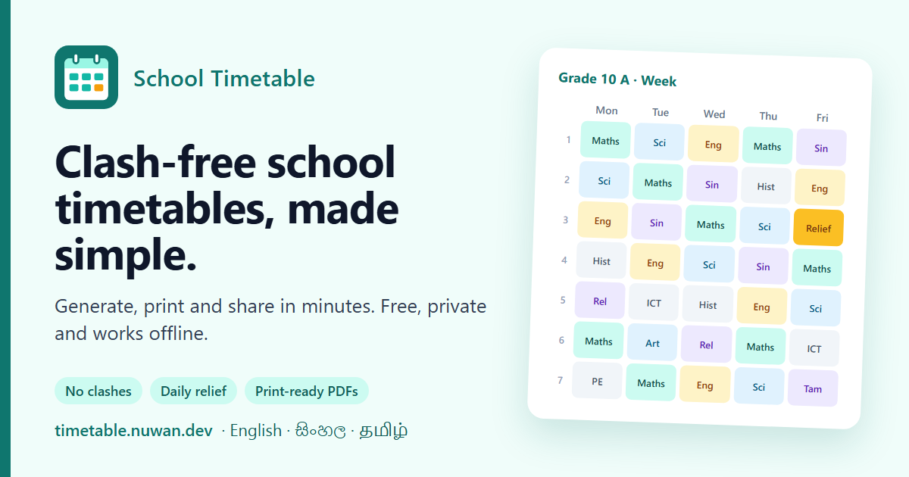

# School Timetable

**Clash-free school timetables, made simple.**



A clash-free school timetable builder that runs as a frontend-only app in the browser. See [PLAN.md](PLAN.md).

- **Use it online:** https://timetable.nuwan.dev/
- **Offline copy:** download [timetable-offline.html](https://timetable.nuwan.dev/timetable-offline.html), copy it to any computer (a pendrive works), and open it in Chrome or Edge.

All data stays on your device. Nothing is uploaded. Projects are saved as `.ttb` files.

Open source under the [MIT License](LICENSE). Contributions are welcome.

```bash
npm install
npm run dev            # http://localhost:5173
npm test               # unit tests (domain, autosave)
npm run build          # static site -> dist/
npm run build:single   # one offline HTML file -> dist-single/index.html
```

## Layout

- `src/domain/`: Zod schemas (the source of truth for all types), the time model, and file migrations
- `src/packs/`: defaults for each school pack (bell schedules, rule presets)
- `src/io/`: open/save of the project file (`.ttb`)
- `src/store/`: Zustand store, IndexedDB autosave and crash recovery
- `src/features/`: screens (start, project overview, PDF spike)
- `docs/spikes/`: spike write-ups

## Branding

The icons, `favicon.ico` and the social preview image in `public/` are rendered from `public/favicon.svg`, `public/icon-maskable.svg` and `scripts/branding/og.html` with `python scripts/branding/render.py` (needs Chrome and Pillow).
